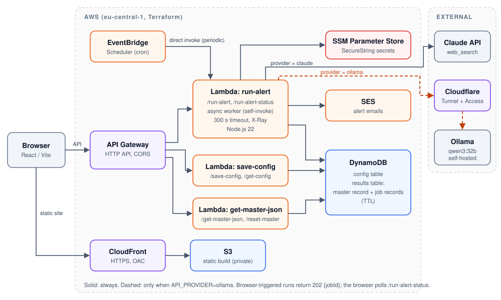

# Monitor CREG

A serverless AWS application that monitors Colombian energy and gas regulation issued by the **CREG** (Comisión de Regulación de Energía y Gas). An LLM-driven web search finds new resolutions, circulars, agreements and technical concepts, accumulates them in one deduplicated record, and sends email alerts when something new appears.

The LLM can be the Anthropic API or a **self-hosted local model (Ollama, `qwen3:32b`)** that the AWS Lambda reaches through a Cloudflare Tunnel.

## Highlights

- **Serverless AWS architecture** defined entirely in Terraform: CloudFront + S3, API Gateway (HTTP API), Lambda (Node.js 22), DynamoDB, SES, EventBridge Scheduler, SSM Parameter Store, IAM, CloudWatch and X-Ray.
- **Local model inference**: a self-hosted `qwen3:32b` served by Ollama, called from Lambda through a Cloudflare Tunnel protected by Cloudflare Access service tokens.
- **Provider abstraction**: one `API_PROVIDER` switch selects Claude or Ollama. The two share a prompt and a JSON schema.
- **Long-running inference behind a 30 s gateway limit**: an async job pattern (`202 { jobId }` plus polling) handles local-model latency of 45-60 s or more.
- **Secrets handling**: all keys live in SSM Parameter Store as SecureString and are fetched at runtime. None sits in the frontend bundle or in plaintext Lambda environment variables.
- **Deterministic test mode**: a UI button replays a stored response, with no key or network needed.

| Directory | What it is |
|---|---|
| [`BIA_react/`](BIA_react/) | React 19 + Vite frontend, plus a local Node backend (`api.js`) for development |
| [`project/`](project/) | AWS deployment: Terraform modules and Lambda functions |

## AWS architecture



| Service | Role |
|---|---|
| CloudFront + S3 | Serves the React build over HTTPS; the bucket is private and reachable only through Origin Access Control |
| API Gateway (HTTP API) | Routes the HTTP contract to three Lambda functions, with CORS |
| Lambda (Node.js 22, ES modules) | `run-alert`, `save-config`, `get-master-json`; X-Ray tracing on, 14-day CloudWatch log retention |
| DynamoDB | A config table and a results table. The results table holds one accumulating master record plus short-lived job records (TTL) |
| SES | Email alerts, with a verified sender identity and optional DKIM |
| EventBridge Scheduler | Periodic runs. It invokes the Lambda directly, because Scheduler cannot POST to an arbitrary HTTP endpoint |
| SSM Parameter Store | SecureString storage for the Claude key, the Ollama key and the Cloudflare Access client ID and secret |
| IAM | Least-privilege execution role, including self-invoke permission for the async worker, and a separate scheduler role |

## Local model inference (Ollama)

`API_PROVIDER=ollama` makes `run-alert` call a self-hosted `qwen3:32b` instead of a hosted API.

- **Reaching a model outside AWS.** The model runs on a machine I control. Lambda calls it through a Cloudflare Tunnel URL (`OLLAMA_BASE_URL`). Every request carries `CF-Access-Client-Id` and `CF-Access-Client-Secret` headers, so Cloudflare Access authenticates the Lambda and the model endpoint is never open to the internet.
- **Secrets.** The service-token pair and the Ollama key are fetched from SSM at runtime and cached.
- **Tool calling.** The model runs a multi-round search loop. Web search goes to Ollama's `web_search` API, not through the tunnel. The final answer is parsed and validated against the JSON schema.
- **Latency.** Local inference takes 45-60 s or more, so the `run-alert` Lambda timeout is 300 s.
- **Async job pattern.** API Gateway HTTP APIs cap integrations at a hard 30 s. For browser-triggered runs, `POST /run-alert` writes a `job#<uuid>` record with a TTL, self-invokes the Lambda asynchronously (`InvocationType: "Event"`), and returns `202 { jobId }`. The worker writes `done` or `error` to the record. The client polls `GET /run-alert-status` every 3 s. The periodic EventBridge run bypasses API Gateway, so it stays synchronous.
- **Local development.** The same provider code runs in `BIA_react/api.js` against Ollama on `localhost:11434`.

Provider code lives in `BIA_react/providers/` and `project/lambdas/run-alert/providers/` (`shared`, `claude`, `ollama`). The two trees are kept in sync.

## Design decisions

- **One master record.** Results accumulate in a single DynamoDB item. Documents are deduplicated by a normalized `numero_nombre` (drop `No.`, collapse whitespace, lowercase), and the fresh response wins on a collision.
- **Deterministic alerting.** What counts as "new" is plain code, not an LLM judgment. An email goes out only if alerts are enabled, there is at least one new item, and the recipient address is valid.
- **Same contract, two backends.** The local Node backend and the Lambdas implement the same five endpoints. The AWS-only `GET /run-alert-status` is hidden from the UI by a client that duck-types the response.
- **Failure isolation.** An SES failure is caught and reported as `emailSent: false`; it never fails the run.
- **Interchangeable data sources.** Live provider and stored test data are selected per request, with no redeploy.

## Infrastructure as code

Terraform (>= 1.5) in [`project/terraform/`](project/terraform/), region `eu-central-1` by default:

| Module | Resources |
|---|---|
| `iam` | Lambda execution role, scheduler role, X-Ray permissions |
| `storage` | DynamoDB config and results tables |
| `email` | SES identity and DKIM |
| `api` | API Gateway, three Lambda functions, log groups |
| `scheduler` | EventBridge Scheduler schedule and invoke policy |
| `frontend` | S3 bucket and CloudFront distribution |

```bash
cd project/lambdas/<fn> && npm install   # per Lambda
cd project/terraform
terraform init && terraform plan && terraform apply
```

Pass secrets as `TF_VAR_*` environment variables and never commit them. A production frontend build must set `VITE_API_BASE` to the API Gateway URL. See [`project/README.md`](project/README.md) for the runbook (SES verification, frontend upload, teardown) and [`project/CONTEXT.md`](project/CONTEXT.md) for the full design record.

## HTTP contract

| Endpoint | Purpose |
|---|---|
| `POST /run-alert` | Run a search and merge the results into the master record |
| `GET /run-alert-status` | AWS only: poll an async job |
| `POST /save-config` / `GET /get-config` | Persist and read user configuration |
| `GET /get-master-json` | Read the master record |
| `POST /reset-master` | Reset the master record to empty |

## Features

- Configurable filters: document type, area, minimum relevance, alert email and frequency.
- AI search over a date range with Claude (server-side `web_search`) or the local Ollama model.
- Email alerts through SES when new documents appear.
- Test-data mode: "Aplicar Búsqueda con datos de prueba" replays a stored response.

## Quick start (local)

Requires Node.js. Run these in `BIA_react/`:

```bash
npm install

# Terminal 1: backend on http://localhost:8787
ANTHROPIC_API_KEY=sk-ant-... npm run backend

# Terminal 2: frontend on http://localhost:5173
npm run dev
```

To use Ollama instead of Claude, run Ollama on `:11434` and start the backend with:

```bash
API_PROVIDER=ollama OLLAMA_API_KEY=... npm run backend
```

To try the app without a key, click **Aplicar Búsqueda con datos de prueba** in the UI.

Other commands: `npm run build`, `npm run lint`, and `node api.js test`. There is no test suite.

## Contributing notes

- Keep `api.js` and `project/lambdas/*` in sync when the HTTP contract or the dedup/merge rules change.
- Don't remove the test-data scaffolding or the unused provider as "dead code".
- Never commit API keys, `.env.production`, or Terraform state or variable files that hold secrets.
- More detail is in [`CLAUDE.md`](CLAUDE.md), [`BIA_react/CLAUDE.md`](BIA_react/CLAUDE.md) and [`project/CLAUDE.md`](project/CLAUDE.md).
